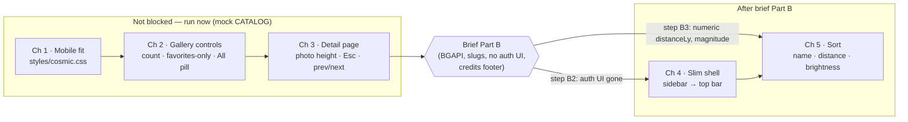

# Plan: UI polish — mobile fit, gallery controls, detail page, slim shell

## 1. Objective

Fix the weak and unfinished parts of the current UI (phone layout, gallery
controls, detail page, empty sidebar) so the real photos and real data are easy
to browse on every screen, without any change to the BGAPI contract.

Found by looking at the app at `http://localhost:4300/` (desktop 1440 px and
phone 390 px) on 2026-11-24. Developer picked all four groups (A–D).

## 2. Diagram

Work is split into **chapters**. Chapters 1–3 do not need the brief
(`docs/briefs/cosmic-origins-platform.md`) and can run **now**. Chapters 4–5
wait for brief Part B.

Mockup of the target look: `docs/plans/ui-polish.png` (phone gallery, desktop
detail, slim top bar).

### What the UI reads (no contract change)

All chapters only read fields that are already in the brief's `/catalog` item
(`slug, name, aliases, category, subcategory, constellation, magnitude,
distanceLy, thumbUrl, credit`) or in today's mock `CATALOG`. Nothing here
adds an endpoint, a field or a slug rule.

**Rejected because it would change the contract:** a short blurb or the
"discovered" year on each card. Both are not in the `/catalog` item. If wanted
later, it must change in the platform plan first.

## 3. Model recommendation

| Chapter | Model | Est. tokens | Why |
|---|---|---|---|
| 1 Mobile fit | Opus (frontier) | ~150k | Look and feel of the design system; needs visual judgment |
| 2 Gallery controls | Sonnet (cheap capable) | ~100k | Small wiring in `cosmic.js`, clear tests |
| 3 Detail page | Opus (frontier) | ~200k | Layout of the main product surface (the photo) |
| 4 Slim shell | Opus (frontier) | ~150k | Replaces the shell layout; design-system work |
| 5 Sort | Sonnet or Haiku | ~60k | One `<select>` and one sort function |

One chapter = one session. Read this plan and the tests file first; do not
re-explore the repo.

## 4. Steps

Rules for every chapter: `renderGrid()` stays the single render entry point.
`CATALOG` field names do not change. UI code uses tokens (`--ion`,
`--signal`, `--ease-hud`, `--t-*`), never raw values. Do not touch the
`data-stub` forms, `initAuthStubs()` or `auth.js` — the brief removes them.
Done = `node --check` on touched JS + app loaded + tests green.

### Chapter 1 — Mobile fit (now) · tests: group T1

Problem seen: at 390 px the page is wider than the screen. Header text, search
box, filter pills, card grid (2 × `minmax(160px)` + 72 px rail does not fit)
and the detail data table are cut off.

1.1 Stop horizontal overflow on every view at 360, 390 and 768 px.
   Works when `document.documentElement.scrollWidth === window.innerWidth` on
   gallery and detail at those widths.
1.2 Card grid: 1 column under ~420 px of content, 2+ above. Cards keep the
   square photo. Works when no card is clipped at 360 px.
1.3 Filter pills: one row that scrolls sideways on phones (no wrap into 3 rows).
   Works when all 8 pills can be reached by swipe and the row is one line.
1.4 Search: input and button fit on one line (button goes away in Ch 2 anyway).
1.5 Header eyebrow text wraps or shortens; nothing is cut mid-word.
1.6 Detail telemetry table: 2 columns on phones, no cut-off cells.
1.7 Hero: prev/next buttons both visible on phones; caption not covered.

### Chapter 2 — Gallery controls (now) · tests: group T2

2.1 **Result count** above the grid, mono + `--signal`: "14 objects" /
   "3 of 14 objects". Updated inside `renderGrid()`.
   Works when the count matches the number of cards after every filter/search.
2.2 **Remove the Search button.** Search already runs on every key press.
   Works when typing filters the grid live and no Search button exists.
2.3 **"All" pill = switch.** All on → click clears every category (so you can
   pick just one). Anything else → click turns every category on. With none
   picked, the empty state says "No category picked".
   Works when "All" clears, a pill then shows only its category, and "All"
   again shows every object. *(Changed 2026-11-24 at Lyuben's request; was
   "never turns all off".)*
2.4 **Favorites-only toggle** (star pill at the end of the pill row). Shows only
   objects whose id is in `co-favs`. Empty result shows a friendly empty state
   ("No favorites yet — tap ☆ on a card").
   Works when the toggle shows exactly the starred cards, and survives a reload
   only for the stars (the toggle itself starts off).
2.5 **Drop the fake favorite count.** The "0" next to the star is a global
   counter with no backend; with no accounts it means nothing. Show the star
   only (empty / filled).
   Works when no card shows a number next to its star.

### Chapter 3 — Detail page (now) · tests: group T3

Problem seen: the photo is ~1300 px tall on desktop, so the name and data sit
below the fold. Data table has empty filler cells. "TELEMETRY · LIVE CATALOG
RECORD" claims the data is live; it is not.

3.1 Photo height max ~60vh (`object-fit: cover`), name + designation on the
   photo's lower edge, data table visible without scrolling at 1440 × 900.
3.2 Click on the photo opens the full original image URL in a new tab
   (the real NASA file — no copy).
3.3 Telemetry grid uses auto-fit columns: no empty filler cells.
3.4 Replace the "LIVE" label with an honest one: "Catalog record".
3.5 **Esc** closes the detail view (same as "Back to gallery").
3.6 **Prev / next** buttons and ← / → keys move through the *current gallery
   list* (same filters, search and later sort), wrapping at the ends.
   Use one helper that builds the object link, so the brief can change
   `#obj/<id>` → `#/object/<slug>` in one place.
3.7 Related rail: bigger tiles (same size as phone cards); label
   "More in <category>". Hidden when empty (as today).

### — Gate: brief Part B —

Chapters 4–5 start only after brief Part B steps 2 (auth UI removed) and 3
(catalog from BGAPI, with mock fallback) are merged. If BGAPI is not reachable
yet, the brief's mock fallback is enough to start: Ch 4 needs only step B2,
Ch 5 needs numeric `distanceLy` / `magnitude` (mock can be mapped once).

### Chapter 4 — Slim shell (after brief step B2) · tests: group T4

After the brief removes Login and Register, the sidebar holds only "Gallery"
and "Ambience". A 248 px column for two buttons wastes space, most of all on
phones (72 px rail).

4.1 Replace the sidebar with a slim top bar: brand on the left, Ambience toggle
   on the right. Gallery link = brand link.
4.2 Remove the decorative UTC clock (it shows no data about any object).
4.3 Remove `co-sidebar` from localStorage use and the collapse button.
4.4 Keep the brief's footer (credits + privacy links) at the bottom.
   Works when the content uses the full width at every size and nothing links
   to removed routes.

### Chapter 5 — Sort (after brief step B3) · tests: group T5

5.1 Sort `<select>` next to the result count: Name (A–Z, default), Distance
   (near → far, `distanceLy`), Brightness (bright → faint, `magnitude`,
   lower is brighter). Objects without a value go last.
5.2 Sorting happens inside `renderGrid()`; prev/next in the detail view follows
   the same order (Ch 3.6).
   Works when the order matches the numbers in each card's detail view.

## 5. Risks

| Risk | Mitigation |
|---|---|
| Ch 1–3 and the brief edit the same files (`index.html`, `cosmic.js`, `cosmic.css`) | Ch 1–3 do not touch auth forms, routing format or data loading. Merge Ch 1–3 before the brief starts. Brief agent reads this plan's "touched" list. |
| Favorites store mock ids (`m31`) today; brief maps them to slugs | Ch 2.4 reads whatever `co-favs` holds; the brief's one-time id → slug map keeps it working. |
| Prev/next hash format changes in the brief | One link helper (3.6); the brief edits one line. |
| Sticky / scrolling pill row hides pills on phones | Test T1.3 swipes to the last pill. |
| Photo cap (60vh) crops tall images badly | `object-position: center` + full image one click away (3.2). |
| Eagle Nebula photo (PIA03096) has black no-data corners — looks like a bug | Not a UI bug. Data job: pick a cleaner photo via `tools/import/hero-images.json` in brief Part A. |
| Two exoplanet photos (TRAPPIST-1e, Kepler-186f) are diagrams / artist concepts | Not in this plan. The brief's image filter already drops concept art. |

## 6. Doc updates (confirm with Lyuben first)

| File | Why |
|---|---|
| `README.md` | New features: favorites-only filter, sort, keyboard (Esc, ← / →), no sidebar |
| `docs/follow-ups.md` | Add "UI polish" with chapter status; mark chapters DONE as they land |
| `CLAUDE.md` | Coupling map: shell no longer has a sidebar (`co-sidebar` gone) after Ch 4 |
