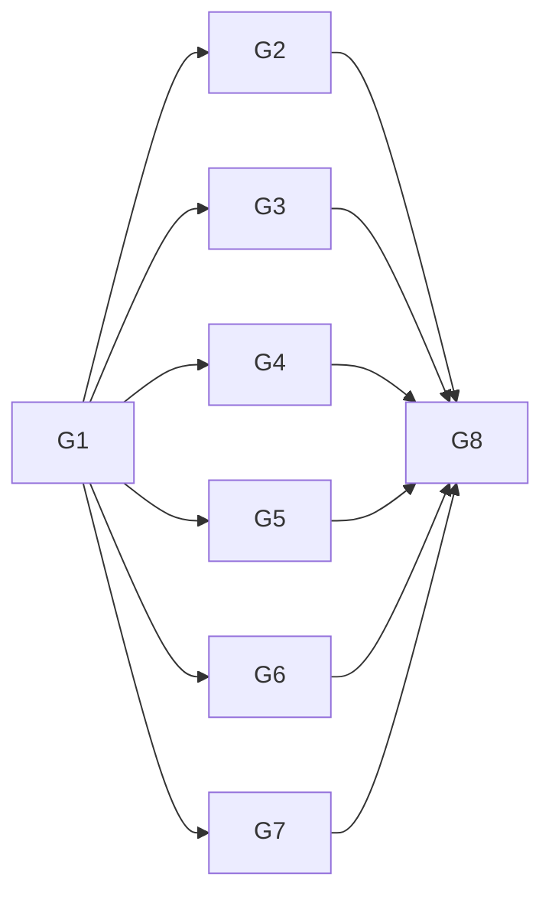

# Tests: automated UI tests

Companion to `docs/plans/ui-tests.md`. Here the "tests for the tests" are
proofs that the suite itself works: it runs offline, it goes red on a real
bug, and CI blocks a bad change.

## 1. Coverage map

| Plan step | Group | What proves it |
|---|---|---|
| 1 Tooling, 2 Config, 3 Helpers | G1 | Clean install, listing, offline load |
| 4 T0 static | G2 | `t0-static.spec.js` green |
| 5 T1 mobile fit | G3 | `t1-mobile-fit.spec.js` green × 3 engines |
| 6 T2 gallery controls | G4 | `t2-gallery-controls.spec.js` green × 3 engines |
| 7 No card rebuild | G5 | Green now; red on the old bug |
| 8 Detail view + console | G6, G7 | Green; red when the wait is removed |
| 9 CI gate | G8 | Red PR check; (after switch) no deploy on red |

## 2. Required setup

- Node 22+, `npm ci`, `npx playwright install chromium firefox webkit`.
- No network needed after install. No seed data: mock `CATALOG` (14 objects).
- Fixture: `tests/fixtures/space.jpg` (one small real JPEG).
- A throwaway copy for red checks: `git stash` is not used; make edits in a
  scratch branch or undo by hand. Never commit a red check.

## 3. Test cases

### G1 — Tooling, config, offline helpers

| ID | Setup | Steps | Expected | Edge cases |
|---|---|---|---|---|
| G1.1 | Clean clone | `npm ci && npx playwright install` | exit 0 | — |
| G1.2 | — | `grep -rn "node_modules\|playwright\|@playwright" index.html src styles` | no match | — |
| G1.3 | — | `npx playwright test --list` | every test listed for chromium, firefox, webkit (T0 only chromium) | — |
| G1.4 | Port 4310 free | `npm test` | server starts by itself, suite runs, server stops | Dev server on 4300 running: no clash |
| G1.5 | Wi-Fi off | `npm test` | same result as with Wi-Fi | — |
| G1.6 | Add a fake `<script src="https://example.com/x.js">` in a local copy | Run one test | Test fails and names `example.com` | Undo the edit |
| G1.7 | — | Star a card in test A; test B checks `localStorage` | Test B sees `co-favs` empty | Run with `--workers=1` too |

### G2 — T0 static

| ID | Expected |
|---|---|
| T0.1 | `node --check` exit 0 for each JS file; failing file named in the message |
| T0.2 | Covered by G7 |
| T0.4 | `renderGrid` defined once |
| T0.3, T0.5 | Stay manual (need a diff); listed as `test.skip` with the reason, so they show in the report |

### G3 — T1 mobile fit (each × 3 engines)

| ID | Viewport | Assertion |
|---|---|---|
| T1.1 | 360, 390, 768 | `scrollWidth === innerWidth`, at top and after `scrollTo(0, bottom)` |
| T1.2 | 360 | `#obj/m31`, `#obj/trappist1e`: no side scroll; every `#telemetry > div` has `left >= 0` and `right <= innerWidth`; exactly 2 distinct `left` values |
| T1.3 | 390, 360 | all `.pill` same `top` (±1 px); last pill after `scrollIntoViewIfNeeded` inside viewport; `click({trial:true})` passes |
| T1.4 | 360 / 768 | 360: 1 distinct card `left`, every card inside viewport, frame `|w − h| <= 1`. 768: ≥ 2 distinct `left` |
| T1.5 | 390 | eyebrow `scrollWidth <= clientWidth` |
| T1.6 | 390 | `#heroPrev`, `#heroNext` boxes inside viewport |
| T1.7 | 1440 | sidebar width, grid columns, hero width equal the numbers recorded from today's app (±2 px); also with sidebar collapsed |

### G4 — T2 gallery controls (1440 and 390, × 3 engines)

| ID | Steps | Assertion | Edge cases |
|---|---|---|---|
| T2.1 | Load | `#resultCount` text `14 objects`; color = resolved `--signal`; font-family contains "IBM Plex Mono" | — |
| T2.2 | Click Galaxies pill | `12 of 14 objects`; 12 visible cards | Type "zzz" → `0 of 14 objects`, `#emptyState` visible |
| T2.3 | Type "orion" | no Search button; visible cards = Orion Nebula, Betelgeuse | Clear → 14 |
| T2.4 | Click All twice | every category pill `aria-pressed=true` both times; 14 cards | 3 off, then All → all on |
| T2.5 | Star m31, europa; click ★ pill | 2 cards; `2 of 14 objects` | Un-star one → 1 card |
| T2.6 | No stars; ★ on | empty state contains "No favorites yet" | — |
| T2.7 | Star a card; reload | star filled; ★ pill `aria-pressed=false` | — |
| T2.8 | Any card | star button text is empty (no digits) | — |

### G5 — Regression: no card rebuild

| ID | Steps | Assertion | Edge cases |
|---|---|---|---|
| G5.1 | Tag every card ``; click a star | same nodes (all tags there), same count; visible card img min opacity over 600 ms = 1 | Click the same star again |
| G5.2 | Click a category pill off, then on | same as G5.1 | Click "All" |
| G5.3 | ★ pill on, then off | same as G5.1 | — |
| G5.4 (red, manual) | In a local copy, make `renderGrid()` always set `grid.innerHTML` | G5.1 fails on "same nodes" | Undo |

### G6 — Detail view

| ID | Setup | Assertion | Edge cases |
|---|---|---|---|
| G6.1 | Open `/#obj/m31` directly | rAF sampler: gallery visible in 0 frames; detail title visible at the end | `/#obj/crab` |
| G6.2 | `imageDelayMs: 1000` | before image response: panel `is-waiting`, title opacity 0; after: `is-entering`, image `complete`; entrance time ≥ response time | Gallery → card click path, not only deep link |
| G6.3 | `imageDelayMs: 4000` | entrance starts between 1.3 s and 2.5 s; page not empty | — |
| G6.4 (red, manual) | Local copy: call `whenReady()` at once in `loadPicture` | G6.2 fails | Undo |

### G7 — Console

| ID | Steps | Assertion |
|---|---|---|
| G7.1 | Load gallery, wait for network idle | 0 console errors, 0 page errors (after ignore list) |
| G7.2 | Load `/#obj/m31`, wait for entrance | same |
| G7.3 | Ignore list | only image-decode patterns; a fake `console.error("x")` via `page.evaluate` makes the check fail |

### G8 — CI gate

| ID | Steps | Expected |
|---|---|---|
| G8.1 | Open a PR with the workflow | `test` job runs, all 3 engines green |
| G8.2 | PR with a deliberately failing test (throwaway branch) | red check; report artifact attached |
| G8.3 | After the Pages switch only: push to `master` | `deploy` runs after `test`; site still at https://baiganio.github.io/cosmic-origins/ |
| G8.4 | After the switch: red `test` on `master` | `deploy` is skipped; live site unchanged |

## 4. Test execution order

G1 first (nothing else runs without it). Then G2, G3, G4, G5, G6, G7 in any
order; tests inside a group are independent. G8 last, because it needs a
green local run. G8.3–G8.4 only after Lyuben approves the Pages switch.

## 5. Discoveries

Update this file if a run changes an expectation (for example, an engine
needs one more ignore pattern — write it here with the exact message).

Found while building (2026-11-24):

- Card pictures fade in after `is-loaded`. Wait for opacity 1, not only for
  the class, before the no-rebuild test starts measuring.
- `page.goto` waits for the "load" event, and "load" waits for slow
  pictures. Timing tests record panel class changes with a
  `MutationObserver` (time + caption opacity) instead of polling afterwards.
- The m31 picture is also a hero slide, so the hero may request it first.
  Tests match the picture response by URL.
- Sidebar width is a CSS transition. T1.7 polls until the sizes settle;
  under full parallel load a single early read failed once in Firefox.
- Desktop numbers (all 3 engines agree): open = sidebar 248, 4 columns,
  hero 1192; collapsed = sidebar 72, 4 columns, hero 1368.
- No ignore pattern was needed: 0 console errors in all 3 engines with the
  local JPEG and the WebGL starfield on.
- Red checks done by hand: always-rebuild `renderGrid()` → no-rebuild test
  fails ("same picture elements"); `loadPicture` calling `ready()` at once →
  slow-picture tests fail ("panel had is-waiting"). File restored after.
