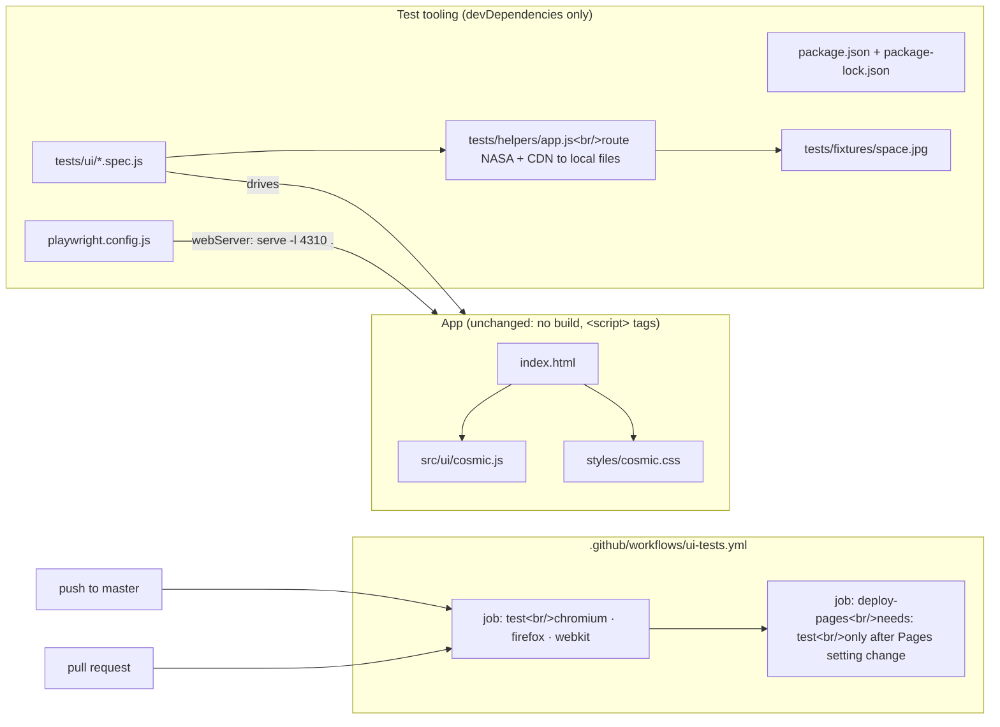

# Plan: automated UI tests (Playwright, 3 engines, CI gate)

## 1. Objective

Catch UI bugs automatically in Chromium, Firefox and WebKit before a push to
`master` deploys them to GitHub Pages, without adding a build step to the app.

Today every UI check is a manual step or a one-off script. The app has no
runner, no `package.json` and no CI. Pages builds straight from `master`
(`build_type: legacy`, source `master /`, checked 2026-11-24).

## 2. Diagram

Nothing in `index.html` or `src/` imports, loads or knows about the tooling.
The arrow only goes from the tests to the app.

## 3. Model recommendation

| Work | Model | Est. tokens | Why |
|---|---|---|---|
| Build + first green run | Sonnet 5.5 (cheap capable) | ~150–200k | The plan and test file fix every file and assertion; the work is wiring, not design |
| Only if one engine stays flaky after 2 tries | Opus 5.5 (frontier) | ~80k extra | Timing bugs across engines need deeper judgment |

One session. Read this plan and `ui-tests-tests.md` first; do not re-explore.

## 4. Steps

Rules: no file in `index.html`, `src/` or `styles/` changes. If a test
needs a hook (an id, a class), stop and ask. Tests use plain CommonJS
JavaScript (no TypeScript), so a junior can read them.

### Step 1 — Tooling in its own place · tests: G1
- Root `package.json`: `"private": true`, no `dependencies`, only
  `devDependencies`: `@playwright/test`, `serve`, and the exact CDN
  versions the app loads (`three@0.147.0`, `bootstrap@5.3.2`,
  `bootstrap-icons@1.13.1`) so tests can serve them offline.
- Scripts: `npm test` (all engines), `npm run test:firefox`,
  `npm run test:report`.
- `package-lock.json` committed (CI uses `npm ci`).
- `.gitignore`: `node_modules/`, `test-results/`, `playwright-report/`.
- Works when `npm ci && npx playwright install` succeeds on a clean clone and
  `grep -rn "node_modules\|playwright" index.html src styles` finds nothing.

### Step 2 — Config · tests: G1
- `playwright.config.js` at the root: `testDir: "tests/ui"`; 3 projects
  (`chromium`, `firefox`, `webkit`); `baseURL http://localhost:4310`.
- `webServer`: `npx serve -l 4310 .`, `reuseExistingServer: !process.env.CI`.
  Port 4310, not 4300, so it does not collide with the dev server from the
  ui-polish docs.
- CI: `retries: 1`, `forbidOnly: true`, reporter `html` + `list`;
  trace and video only on failure.
- Works when `npx playwright test --list` lists every test 3 times.

### Step 3 — Offline + deterministic helpers · tests: G1
`tests/helpers/app.js` exports one `test` (extends `@playwright/test`):
- **Before each test:** `context.route`:
  - `images-assets.nasa.gov/**` and `images-api.nasa.gov/**` → `tests/fixtures/space.jpg`
    (one small real JPEG, ~5 KB, made once, committed).
  - `cdn.jsdelivr.net` three / bootstrap / bootstrap-icons (css, js, fonts) →
    the same file from `node_modules`.
  - `fonts.googleapis.com` → empty CSS; `fonts.gstatic.com` → abort.
  - Any other outside host → abort **and** record it; the test fails if any
    unexpected outside request happened. This keeps the suite honest when the
    app adds a new CDN.
- **Clean storage:** `localStorage.clear()` before the app script runs
  (`addInitScript` guarded by a one-time flag so a test can still reload and
  keep its own stars, for T2.7).
- **Console watcher:** collects `console` errors and `pageerror`. Ignores
  only image-decode messages (pattern list in one place, with a comment).
- Fixture option `imageDelayMs` (default 0) delays the NASA route, for the
  slow-picture test.
- Small measure helpers: `noSideScroll(page)`, `box(locator)`,
  `sampleOpacity(locator, ms)` (reads `getComputedStyle` every animation
  frame inside the page, returns min / max).
- Works when a test with the network turned off (`context.setOffline` is
  not used; routes cover everything) loads the app with zero unexpected requests.

### Step 4 — T0 static checks · tests: G2
`tests/ui/t0-static.spec.js` (runs once, `chromium` project only, no page):
- T0.1 `node --check` on every `.js` file in `src/`, `tests/`, root config.
- T0.4 `renderGrid` is defined exactly once in `src/ui/cosmic.js`.
- T0.2 lives in the console test (Step 8).
- T0.3 (raw colors in a diff) and T0.5 (compare with `HEAD`) need a diff and
  human eyes. They stay manual; the tests file says so.

### Step 5 — T1 mobile fit · tests: G3
`tests/ui/t1-mobile-fit.spec.js`, one describe per viewport
(360 × 780, 390 × 844, 768 × 1024, 1440 × 900). Measures, no screenshots:
- T1.1 `scrollWidth === innerWidth` on gallery, top and bottom.
- T1.2 `#obj/m31` and `#obj/trappist1e` at 360: no side scroll; every
  telemetry cell's box is inside the viewport width; 2 columns (2 distinct
  `left` values).
- T1.3 pill row: all pills share one `top`; last pill scrolled into view is
  inside the viewport and clickable (`trial: true`).
- T1.4 at 360: cards share one `left` (1 column); each card inside the
  viewport; photo frame width ≈ height (±1 px). At 768: 2+ distinct `left`.
- T1.5 eyebrow: `scrollWidth <= clientWidth` (nothing cut).
- T1.6 hero prev / next boxes fully inside the viewport.
- T1.7 at 1440: measure the desktop layout (sidebar width, grid column count,
  hero width). Expected numbers are taken from today's app once and written
  into the test with a comment.

### Step 6 — T2 gallery controls · tests: G4
`tests/ui/t2-gallery-controls.spec.js` at 1440 and 390: T2.1–T2.8 exactly
as in `ui-polish-tests.md`. Count text exact; color equals the resolved
`--signal`; font-family contains "IBM Plex Mono". Cards counted with
`:not([hidden])`.

### Step 7 — Regression: no card rebuild · tests: G5
`tests/ui/regression-no-rebuild.spec.js`:
- Wait until every card `` has `is-loaded`.
- Tag every `` with a JS property (`img.__probe = n`).
- Click a star, then a filter pill (off and on), then "All", then the ★ pill.
- After each click: same `` count, every `__probe` still there (same
  DOM node), and `sampleOpacity` over 600 ms has min = 1 for visible cards.
- Red check (manual, one time): temporarily put the old rebuild line back in a
  local copy and confirm the test fails. Not committed.

### Step 8 — Detail view + console · tests: G6, G7
`tests/ui/detail-view.spec.js`:
- No flash: an init script samples, every animation frame from the first
  paint, whether `#view-gallery` is visible (`body` visibility, view
  `display` / opacity). Open `/#obj/m31`. Expected: gallery never visible
  while the hash is `#obj/m31`; detail title becomes visible.
- Waits for the picture: `imageDelayMs: 1000`. Before the image response:
  panel has `is-waiting`, title opacity 0. After: `is-waiting` gone,
  `is-entering` added, image `complete`. The time the entrance starts is
  not before the image response time.
- Safety net: `imageDelayMs: 4000` → entrance still starts at ~1.5 s
  (between 1.3 s and 2.5 s).
`tests/ui/console.spec.js`: load gallery and `#obj/m31`; zero console
errors and zero page errors (after the ignore list).

### Step 9 — CI gate · tests: G8
`.github/workflows/ui-tests.yml`:
- `on: pull_request`, `push: branches: [master]`, `workflow_dispatch`.
- Job `test` (ubuntu-latest, Node 22): `npm ci`,
  `npx playwright install --with-deps chromium firefox webkit`,
  `npm test`. Upload `playwright-report/` as an artifact on failure.
- Job `deploy` (**only after Lyuben says yes**, see Risks):
  `needs: test`, only on push to `master`; `actions/upload-pages-artifact`
  (repo root, same files Pages serves today) + `actions/deploy-pages`.
  Needs Settings → Pages → Source = "GitHub Actions".
- Works when a PR with a broken test shows a red check, and (after the switch)
  a red `test` job means no `deploy` job runs.

## 5. Risks

| Risk | Mitigation |
|---|---|
| Today Pages deploys from `master` by itself. A red CI check does **not** stop it. | Switch Pages source to "GitHub Actions" and deploy from a job that `needs: test`. This is a hosting change: ask first. Until then CI only warns. |
| Pages switch breaks the live site | Same files, same URL. Rollback = set Source back to "Deploy from a branch → master /". |
| `tests/`, `package.json` become public on Pages | Already public in the repo. `node_modules` is gitignored, so not deployed. |
| WebGL starfield fails in headless WebKit / Firefox → console error | App already has a 2D fallback. If an engine logs a GPU warning as an error, add it to the ignore list with a comment, never a blanket ignore. |
| Timing tests flake on slow CI machines | Sample in the page with `requestAnimationFrame`; wide windows (1.3–2.5 s); `retries: 1` only in CI; a retry that passes is still shown as "flaky" in the report. |
| CDN version in `index.html` changes, local copy does not | Offline helper reads versions from the URL; unknown URL = aborted + test fails with the URL in the message. |
| Uncommitted UI changes in the working tree right now | Suite tests the working tree. Commit the UI work first, then the tests, so each commit is green. |
| Two copies of the truth (manual `ui-polish-tests.md` and specs) | Each spec test name starts with its ID (`T2.5 …`). The manual file links to the spec. |

## 6. Doc updates (confirm with Lyuben first)

| File | Why |
|---|---|
| `CLAUDE.md` | Lines 43–45 (Done means: add `npm test` green), 55–62 (Quick Start: add `npm ci`, `npm test`; drop "no tests"), Tech Stack (add Testing line), 73 (Hosting, only if Pages switches), 148 ("since there is no test runner") |
| `README.md` | New "Run the tests" section: `npm ci`, `npx playwright install`, `npm test` |
| `docs/follow-ups.md` | Add "Automated UI tests" as DONE; add "Pages deploys from Actions" if switched |
| `docs/plans/ui-polish-tests.md` | T0–T2 rows: note "automated in `tests/ui/…`" |
